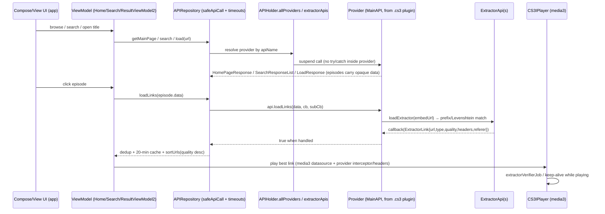

# Provider Architecture (CloudStream)

**Scope:** how a "provider" is defined, registered, and driven through search → homepage → title details → episode list → playback-link resolution, with exact code citations.
**Method:** static code reading at `recloudstream/cloudstream@eb962b4`. Everything below is **VERIFIED** unless marked otherwise.

---

## 1. The provider contract: `MainAPI`

File: `library/src/commonMain/kotlin/com/lagradost/cloudstream3/MainAPI.kt` (2,861 lines). This file is in the KMP `commonMain` source set — the contract contains **no Android imports**.

### 1.1 Identity & capability properties (`abstract class MainAPI`, line 494)

| Property | Line | Purpose |
|---|---|---|
| `name`, `mainUrl`, `storedCredentials` | 515–519 | Provider display name, base URL, optional credentials; `overrideWithNewData()` (506) lets users clone/replace sites |
| `canBeOverridden` | 520 | Clone-site opt-out |
| `sequentialMainPage`, `sequentialMainPageDelay`, `sequentialMainPageScrollDelay` | 524–531 | Rate-limit hints: request homepage sequentially instead of in parallel |
| `lang` | 546 | IETF BCP-47 content language |
| `instantLinkLoading` | 549 | Links already resolvable from `Episode.data` |
| `hasChromecastSupport`, `hasDownloadSupport` | 552–555 | Player capability flags |
| `usesWebView` | 558 | "Used for testing and can be used to disable the providers if WebView is not available" — the contract itself acknowledges non-WebView hosts |
| `sourcePlugin` | 561 | Which `.cs3` file registered this provider (set by `BasePlugin.registerMainAPI`) |
| `hasMainPage`, `hasQuickSearch` | 563–564 | UI capability flags |
| `*TimeoutMs` (`loadLinksTimeoutMs`, `getMainPageTimeoutMs`, `searchTimeoutMs`, `quickSearchTimeoutMs`, `loadTimeoutMs`) | 573–601 | Per-method timeout hints enforced by the host |
| `supportedSyncNames` | 616 | Sync-ID → URL mapping support (`getLoadUrl`) |
| `supportedTypes` | 618–624 | Default `setOf(TvType.Movie, TvSeries, Cartoon, Anime, OVA)` |
| `vpnStatus`, `providerType` | 626–627 | Metadata surfaced in the extension list UI |
| `mainPage` | 630 | `List<MainPageData>` — declarative homepage rows |

### 1.2 The five lifecycle methods

All are `open suspend fun` with `throw NotImplementedError()` defaults — providers override what they support (lines 633–712):

```kotlin
open suspend fun getMainPage(page: Int, request: MainPageRequest): HomePageResponse?   // 633
open suspend fun search(query: String, page: Int): SearchResponseList?                 // 641 (paginated)
open suspend fun search(query: String): List<SearchResponse>?                          // 651 (legacy single page)
open suspend fun quickSearch(query: String): List<SearchResponse>?                     // 656
open suspend fun load(url: String): LoadResponse?                                      // 665
open suspend fun loadLinks(
    data: String, isCasting: Boolean,
    subtitleCallback: (SubtitleFile) -> Unit,
    callback: (ExtractorLink) -> Unit): Boolean                                        // 692–699
open suspend fun extractorVerifierJob(extractorData: String?)                          // 679 — keep-alive polling while playing
open fun getVideoInterceptor(extractorLink: ExtractorLink): Interceptor?               // 702 — okhttp interceptor handed to the player's data source
open suspend fun getLoadUrl(name: SyncIdName, id: String): String?                     // 710 — sync-ID (IMDb/MAL) deep link
```

Key contract semantics (**VERIFIED** from doc-comments and host code):

- *"Every provider will **not** have try catch built in, so handle exceptions when calling these functions"* (comment above line 494) — error handling is the **host's** job (see `APIRepository`, §4).
- `load()` returns a `LoadResponse` whose episodes carry an opaque `data` string (a URL or a JSON blob — `newEpisode(data: T)` serializes any payload to JSON, `MainAPI.kt:2629–2637`).
- `loadLinks()` is a **callback-streaming** API: providers emit `ExtractorLink`s and `SubtitleFile`s asynchronously as they resolve them; the host deduplicates, caches, and sorts.

---

## 2. Data model (all in `MainAPI.kt` unless noted)

### 2.1 Catalog types

- **`TvType`** enum (line 1120): 18 values — `Movie(1), AnimeMovie(2), TvSeries(3), Cartoon(4), Anime(5), OVA(6), Torrent(7), Documentary(8), AsianDrama(9), Live(10), NSFW(11), Others(12), Music(13), AudioBook(14), CustomMedia(15), Audio(16), Podcast(17), Video(18)`.
- **`SearchResponse`** interface (line 1406): `name, url, apiName, type, posterUrl, posterHeaders, id, quality, score`. Concrete variants: `MovieSearchResponse` (1655), `TvSeriesSearchResponse` (1727), `AnimeSearchResponse` (1555), `LiveSearchResponse` (1691), `TorrentSearchResponse` (1621). Builder-style constructors are `MainAPI` extension functions (`newMovieSearchResponse` etc.) that auto-`fixUrl()` and stamp `apiName`.
- **`SearchQuality`** (1303), **`Score`** (919 — score with configurable scale).
- **Homepage**: `HomePageResponse` (1270, wraps `List<HomePageList>` + `hasNext`), `HomePageList` (1282: `name`, `list`, `isHorizontalImages`), `MainPageData` (410: `name`, `data`, `horizontalImages`), `MainPageRequest` (416).

### 2.2 Detail types — `LoadResponse` interface (line 1814)

Fields: `name, url, apiName, type, posterUrl, year, plot, score, tags, duration(min), trailers, recommendations, actors, comingSoon, syncData, posterHeaders, backgroundPosterUrl, logoUrl, contentRating, uniqueUrl`. The `companion object` (1837+) implements a **JSON-encoded multi-service ID string** (`addIdToString`/`readIdFromString`, 1846–1856) that stores IMDb/TMDb/MAL/AniList/Kitsu IDs inside `syncData` for tracker sync.

Concrete variants:

| Type | Line | Episodes field |
|---|---|---|
| `MovieLoadResponse` | 2463 | single `dataUrl` |
| `TvSeriesLoadResponse` | 2675 | `episodes: List<Episode>` + `seasonNames` etc. |
| `AnimeLoadResponse` | 2320 | per-dub `episodes: Map<DubStatus, List<Episode>>` |
| `LiveStreamLoadResponse` | 2414 | live `dataUrl` |
| `TorrentLoadResponse` | 2268 | torrent/magnet |

- **`Episode`** (2552): `data` (opaque string), `name, season, episode, posterUrl, score, description, date(epoch ms), runTime`. `Episode.addDate()` (2576–2613) demonstrates the defensive parsing style (ISO-8601 → custom format → date-only fallbacks).
- **`DubStatus`** (905), **`SeasonData`** (2227), **`Actor/ActorData/ActorRole`** (1524–1553), **`TrailerData`** (1779), **`SubtitleFile`** (1205: `url`, `language`, `filename`...).

### 2.3 Playback types — `utils/ExtractorApi.kt`

- **`ExtractorLink`** open class (line 703, `@Serializable`): `source, name, url, referer, quality, headers: Map<String,String>, extractorData, type, audioTracks`. Implements `IDownloadableMinimum` (2654 in MainAPI.kt: `url, referer, headers`). Helpers: `isM3u8`/`isDash` (718–719), `getVideoSize()` via HEAD request (728–739), `getAllHeaders()` merges referer (742–749).
- **`ExtractorLinkType`** enum (417): `VIDEO` (progressive bytes), `M3U8` (HLS, "has support for encrypted m3u8s"), `DASH` (MPD, "currently no download support"), `TORRENT`, `MAGNET` (both "No support at the moment"); `getMimeType()` maps to IANA types (435–443). `inferTypeFromUrl()` (446) infers from file extension.
- **`DrmExtractorLink`** (591): adds `kid`, `key` (ClearKey-style oct key), `uuid` (`CLEARKEY_DRM_UUID` 471, `WIDEVINE_DRM_UUID` 480, `PLAYREADY_DRM_UUID` 490), `kty`, `keyRequestParameters`, `licenseUrl`.
- **`ExtractorLinkPlayList`** (372): concatenated-clip playlists; **`PlayListItem`**/`AudioFile` support separate audio tracks.
- Builder API: `newExtractorLink {}` (503), `newDrmExtractorLink {}` (529/552).

---

## 3. Registration & discovery

### 3.1 Registry — `APIHolder` (`MainAPI.kt:109`)

- `val allProviders = atomicListOf<MainAPI>()` (115) — every registered provider instance.
- `addPluginMapping`/`removePluginMapping` (134–146) maintain `apis` + a name→index `apiMap`; `getApiFromNameNull(name)` (155) resolves a provider by `apiName`; `getApiFromUrlNull(url)` (167) resolves by URL prefix match.
- `initAll()` (117) applies `ProvidersInfoJson` overrides (clone-site feature: user-supplied name/URL/credentials, `MainAPI.kt:398–407`).
- Also hosts tracker helpers (`getTracker` → AniList GraphQL, 246–285) and `getCaptchaToken()` (187–226 — reCAPTCHA v3 anchor/reload dance used by some providers).

### 3.2 Plugin entry point

Extensions ship one class annotated `@CloudstreamPlugin` extending `BasePlugin` (`library/.../plugins/CloudstreamPlugin.kt:7–8`, `BasePlugin.kt:14`). In `load()` the plugin calls:

```kotlin
fun registerMainAPI(element: MainAPI)      // BasePlugin.kt:20 — sets element.sourcePlugin, adds to APIHolder
fun registerExtractorAPI(element: ExtractorApi)  // BasePlugin.kt:31 — adds to extractorApis
```

Host-side loading is `app/.../plugins/PluginManager.kt` (documented in `repository-analysis.md` §5): `PathClassLoader` on the `.cs3`, reflective instantiation of `manifest.pluginClassName`, `pluginInstance.load()` (lines 611–673). Unloading filters registries by `sourcePlugin` (689–731).

---

## 4. Host orchestration layer (Android app)

The UI never calls providers directly; it goes through two layers (**all paths VERIFIED**):

### 4.1 `APIRepository` — `app/src/main/java/com/lagradost/cloudstream3/ui/APIRepository.kt`

A thin wrapper adding error safety and timeouts (honoring `MainAPI`'s timeout hints):

- `load(url): Resource<LoadResponse>` (85) → `safeApiCall { api.load(url) }`
- `search(query, page)` (123), `quickSearch` (136), `getMainPage(page, nameIndex)` (156)
- `loadLinks(...)` (204–220):
  ```kotlin
  if (isInvalidData(data)) return false
  withTimeout(getTimeout(api.loadLinksTimeoutMs)) {
      api.loadLinks(data, isCasting, subtitleCallback, callback)
  }
  ```

### 4.2 ViewModels (call-site evidence)

- **Homepage** — `ui/home/HomeViewModel.kt`: initial load `repo?.getMainPage(1, null)` (341); infinite scroll computes the next page from `MainPageRequest` (247).
- **Search** — `ui/search/SearchViewModel.kt`: paginated `repo.search(query, nextPage)` (137); live/quick search switches to `a.quickSearch(query)` vs `a.search(query, 1)` (235).
- **Details** — `ui/result/ResultViewModel2.kt` drives `APIRepository.load(...)` and orchestrates episode list, watch-state persistence, and link loading (`handleAction` → `handleEpisodeClickEvent`, 1339+).
- **Playback links** — `ResultViewModel2.loadLinks` (1265–1316) delegates to a **`VideoGenerator`**; the catalog-backed generator is `ui/player/RepoLinkGenerator.kt`:

  ```kotlin
  APIRepository(getApiFromNameNull(current.apiName) ?: throw ...)
      .loadLinks(current.data, isCasting = ..., subtitleCallback = ..., callback = ...)
  ```
  (RepoLinkGenerator.kt:107–152). It maintains a per `(apiName, episodeId)` cache with a **20-minute expiry** (lines 30–32, 73), deduplicates by URL via concurrent sets (66–69), de-HTML-ifies and dedupes subtitle names (120–126), and finally sorts with `sortUrls()` (quality-descending, `MainAPI.kt:769–771`).

### 4.3 Player

`ui/player/CS3IPlayer.kt` wraps **androidx.media3 (ExoPlayer 1.9.3)** (`CS3IPlayer.kt:20–22` imports; `gradle/libs.versions.toml:40`). Data sources include `media3-datasource-okhttp` and `-cronet` (`toml:121–125`), which is how `getVideoInterceptor()` and per-link `headers`/`referer` are honored. A vendored `UpdatedMatroskaExtractor.kt` patches MKV/EBML reading. Subtitle pipeline: `PlayerSubtitleHelper.getSubtitleData(...)` converts `SubtitleFile` → `SubtitleData` (RepoLinkGenerator.kt:114).

---

## 5. Link resolution: the extractor pipeline

### 5.1 `ExtractorApi` base class (`utils/ExtractorApi.kt:1425`)

```kotlin
abstract class ExtractorApi {
    abstract val name: String
    abstract val mainUrl: String
    abstract val requiresReferer: Boolean
    var sourcePlugin: String? = null
    open suspend fun getUrl(url, referer, subtitleCallback, callback)   // 1439 — new-style, subtitle-aware
    suspend fun getSafeUrl(...)                                         // 1449 — exception-swallowing wrapper
    open suspend fun getUrl(url, referer): List<ExtractorLink>?         // 1465 — legacy style
}
```

Two coexisting styles: legacy extractors return a list; new-style extractors stream through `callback` (and emit subtitles). Built-in registry `extractorApis` (line 988, `AtomicMutableList`) is pre-populated with ~100 extractors (`Mp4Upload, StreamTape*, MixDrop*, XStreamCdn, StreamSB, Dood, Filemoon, StreamWish, OkRu, ...`).

### 5.2 Matching — `loadExtractor()` (`ExtractorApi.kt:926–986`)

Algorithm (**VERIFIED**):
1. `unshortenLinkSafe(url)` — resolve shorteners first (line 931).
2. Normalize: lowercase + strip schema (932–933).
3. **Reverse-order scan** of `extractorApis` — "Iterate in reverse order so the new registered ExtractorApi takes priority" (936) — prefix-match against each extractor's `mainUrl` (938–948). This means *plugin-registered extractors override built-ins for the same domain*.
4. Fallback: fuzzy mirror-domain matching with `Levenshtein.partialRatio(extractor.mainUrl, currentUrl) > 80` (952–966).
5. Exceptions are logged, never propagated (except `CancellationException` for timeout propagation).

### 5.3 The two resolution paths

1. **Provider-internal:** `MainAPI.loadLinks()` itself resolves links (e.g. scraping the provider's own embeds) — it may call `loadExtractor()` for third-party embeds. Convention: providers return `true` if they handled the data.
2. **Host fallback:** when an `Episode.data` is a bare embed URL, host code calls `loadExtractor()` directly (e.g. `ResultViewModel2.kt:2458`).

Anti-bot support (Android-only): `WebViewResolver` (JS challenge solving inside an Android `WebView`, `expect/actual`) and `CloudflareKiller`/`DdosGuardKiller` cookie interceptors (`app/network/`). The JVM actual of `WebViewResolver.resolveUsingWebView` is `TODO("Not yet implemented")` (`WebViewResolver.jvm.kt:63`) — link extraction requiring a JS browser environment does **not** work on the desktop JVM today.

---

## 6. End-to-end sequence



---

## 7. Porting notes for the web project (summary)

The full contract semantics to replicate in TypeScript are:

1. **Provider interface**: `getMainPage(page, req)`, `search(query, page)`, `quickSearch(query)`, `load(url)`, `loadLinks(data, emit)` — with host-owned error boundaries, timeouts, and cancellation.
2. **Value shapes**: `SearchResponse`, `HomePageResponse/HomePageList`, `LoadResponse` variants (movie/tvseries/anime/live), `Episode{data}`, `ExtractorLink{url,type,quality,headers,referer}`, `SubtitleFile`, `TvType`, `ExtractorLinkType`.
3. **Extractor layer**: separate registry keyed by `mainUrl` prefix match (newest wins) with fuzzy mirror fallback; streaming callbacks; dedupe + sort + TTL cache at the host level.
4. **Registration**: a manifest (name, entry class/file, version, apiVersion) and a repository index format (`repo.json` → `pluginLists` → `plugins.json`) — the web equivalent can be a build-time provider registry plus the same JSON shapes for compatibility.

Detailed browser-side feasibility of each piece is in `web-compatibility-report.md`; sequencing in `implementation-roadmap.md`.
